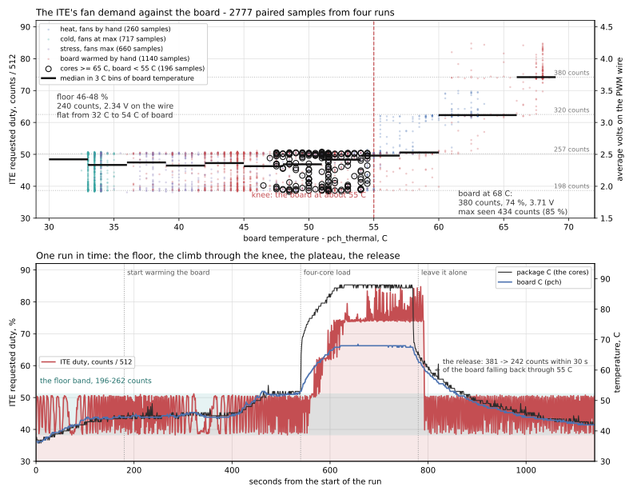
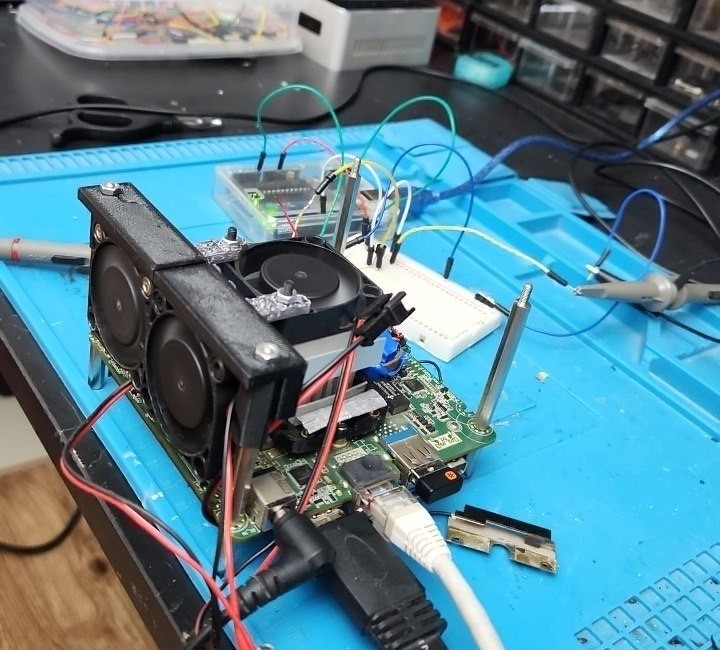
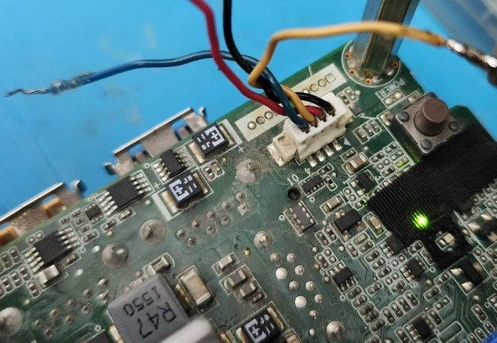
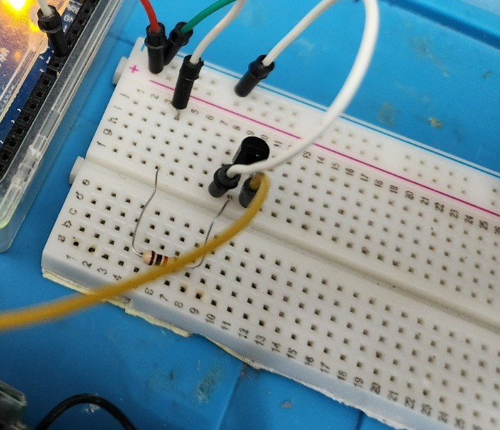
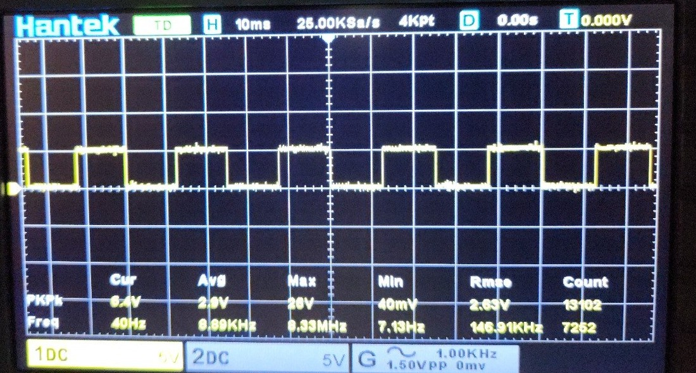
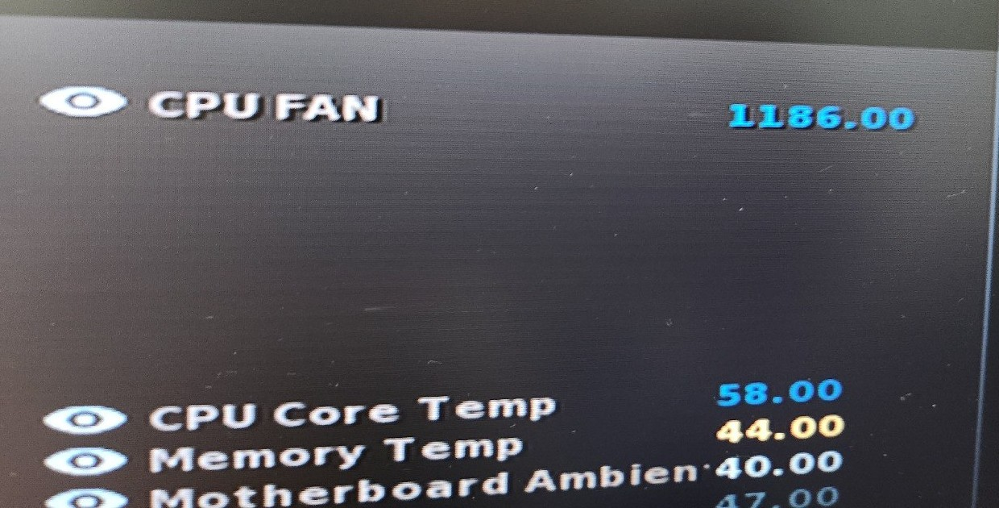
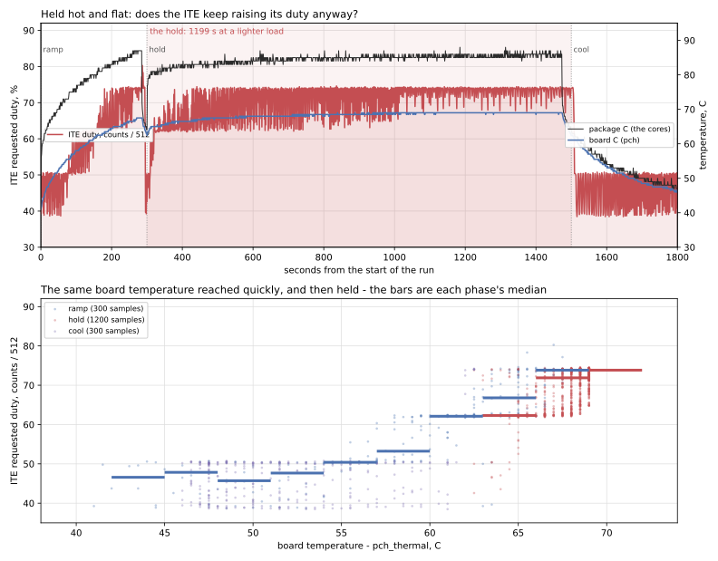

# nuc-fan-controller

A board that lets three 12 V two‑pin fans be used in place of a NUC's stock 5 V fan, and that
answers the NUC's tach input so the BIOS believes the fan it is asking for.

It does four things:

1. **brings 12 V to the fans from a ready‑made module** — an XL4016E1 step‑down (8 A, ~180 kHz) bolted
   to the enclosure wall and wired to this board through **J6**: 19 V in on pin 3, its two returns on
   pins 1–2, 12 V out on pin 4. The board's own 12 V parts are only C3 470 µF/25 V and C4 100 n;
2. **12 V → 5 V → 3.3 V** for a 3.3 V / 8 MHz Arduino Pro Mini (AMS1117‑5.0 then AMS1117‑3.3,
   into the Pro Mini's **VCC**; RAW unused);
3. **follows the duty the NUC's ITE asks for** — the ITE's PWM wire is divided to 2.96 V, read
   on A0, and re‑made as 31.25 kHz on D11 driving Q2 → IRFZ44N → the fans;
4. **simulates the tach signal** — Timer1 hardware square wave on D9 sinks Q1's open collector;
   the pull‑up lives in the NUC. `RPM = 30 × f_tach` (the ITE IT8607E counts 2 pulses per turn).

Board: 124 × 85 mm, 2 layers, GND poured both sides with 322 stitching vias, `Power` net class
1.5 mm on 19V / +12V / FAN_SW / +3V3 / GND. **ERC 0 violations. DRC 0 violations,
0 unconnected items**, one schematic‑parity warning: `J2` pin 4 carries a deliberate no‑connect
(it is the NUC header's own fan supply, which this board never touches).

**A reversal worth stating.** The first version of this board built its 19 V → 12 V converter out of
discrete parts — LM2596T‑ADJ, a 100 µH / 6 A toroid, a 1N5822 catch diode and a 10 kΩ trimmer — because
the XL4016E1 module in the cabinet had been ruled out. That ruling is now lifted: the converter is that
module, and U1, L1, D1, C1, C2, R1 and RV1 came off the board in exchange for one 4‑pin header. The
discrete design is in git at `10bc262` and every part of it is still in the cabinet, so the swap goes
both ways. *BUILD.md* carries the arithmetic that makes the module the better choice at 12 V / 0.3 A.

## Open it without KiCad

[`exports/index.html`](exports/index.html) — schematic, both board views, BOM, links.

| File | What it is |
|---|---|
| `nuc-fan-controller.kicad_sch` / `.kicad_pcb` / `.kicad_pro` | KiCad 10 design |
| `exports/nuc-fan-controller_schematic.pdf` / `.svg` | schematic, wires not net labels, name tags on every signal net |
| `exports/nuc-fan-controller_board.pdf`, `…_board_bottom.pdf`, `…_board.svg` | board plots |
| `exports/nuc-fan-controller_bom.csv` | 33 fitted parts — the buck module is a purchased part wired to J6, so it is correctly not in it |
| `exports/fab/` | 8 Gerbers + `.drl` + `_pos.csv` + `job.gbrjob` — ready to zip and order |
| `firmware/nuc-tach-modeB/nuc-tach-modeB.ino` | the sketch; calibration constants at the top |
| `firmware/probe-uno/probe-uno.ino` | breadboard probe sketch for an Uno (5 V / 16 MHz): tach wave on D9 with the measured `ITE_READ_GAIN` applied, 31.25 kHz fan drive on D11 — for scope-checking the BC547 stages before the board exists |
| `firmware/probe-gain/probe-gain.ino` | sweep sketch: an exact ladder of tach claims (900–3000 RPM, 20 s each) with the fan following the ITE's demand, printing the divider's own count — measures the ITE's read gain and logs its fan curve |
| `firmware/probe-loop/probe-loop.ino` | test sketch: fan drive pinned, tach claims stepped 800 / 2000 / 4500 RPM — measures whether the ITE's demand answers the tach at all |
| `firmware/probe-temp/probe-temp.ino` | test sketch: claim frozen at 1500 RPM — measures whether the demand answers temperature, and what the ITE's floor demand is when the machine is cold |
| `firmware/probe-divider/probe-divider.ino` | test sketch: measures the divider's own ratio with nothing but the Uno, by feeding the chain from the Uno's 5 V pin so the rail voltage cancels |
| `bench/analyze-ladder.py`, `bench/analyze-temp.py`, `bench/analyze-cold.py`, `bench/analyze-heat.py` | the analysers that produced the numbers below, run against `bench/data/` — `analyze-heat.py` is the one that separates the cores from the board |
| `bench/analyze-hold.py` | the analyser for the "does it integrate time?" test: flat-window trend, same-temperature early against late, and a two-variable fit |
| `bench/plot-curve.py`, `bench/plot-hold.py` | draw `docs/bench/06-ite-fan-response.svg` and `docs/bench/07-ite-hold-test.svg`, the two graphs below, from the same logs |
| `bench/data/` | the raw logs: 1 Hz traces of the divider reading, and of the NUC's temperatures |
| `BUILD.md` | the build sheet: header identification with a meter, setting the module to 12.0 V, calibration, bench order |
| `docs/parts-collection.html` | the collection sheet: every BOM line with the exact cabinet drawer it comes from, in drawer‑walk order, plus the eight measurements that decide the footprints (also `docs/parts-collection.md`) |
| `archive/modeA-2026-10-19/` | the fixed‑RPM tach simulator this board replaced |

## On the bench

The board itself is not built yet. Its two control signals have been measured on a breadboard, with
an Uno standing in for the Pro Mini and the ITE's own behaviour logged at 1 Hz. Full numbers and the
raw logs are in `BUILD.md` and `bench/`; these are the measurements that changed the design.

**The whole result in one picture** — 4 577 paired samples from five runs. Top: the ITE's requested duty
against the temperature of the *board* (`pch_thermal`), every sample as a dot, the heavy line being the
median in 3 °C bins, the dotted lines the dwell levels the ITE actually holds. The open circles are the
247 samples where the cores sat at 65 °C or hotter while the board stayed under 55 °C — they land on the
floor, not on the ramp, which is what makes the board the axis and the cores not. Bottom left: the fourth
run in time, board warmed by hand with the bench fans off and the NUC's own blower at minimum, then a
four‑core load, then left alone. Bottom right: the fifth run in time, held at 68.5–69 °C for sixteen flat
minutes — the duty sits on 378 counts for all of it. `bench/plot-curve.py` draws it from `bench/data/`.





**The harness into the NUC's fan header.** Four wires, no published pinout — `BUILD.md` identifies
them with a meter before anything is spliced. The tach and PWM wires go to the breadboard; the
header's own fan supply is left unconnected, which is the deliberate no‑connect on `J2` pin 4.



**The duty‑read chain.** The ITE's PWM wire through the series resistors to the tap, the tap to A0,
the bottom resistor and the caps to ground. A0 sits at the tap — put it at the far end of the chain
and nothing divides, because the AVR draws no current.



**The ITE's PWM is 23 kHz, not an assumption.** A scope on the PWM wire reads a 23 kHz square at
45 % duty mid‑sweep — inside Intel's 25 kHz ±10 % for a 4‑wire fan. At that frequency the divider and
C10/C11 are comfortably over‑specified: τ = 4.49 ms against a 43.5 µs period leaves 7 mV of ripple at
the ADC, 0.24 % of the duty span.

**The tach is read, and it is read 1 % low.** The scope on the tach line:



and the NUC's own hardware monitor, 40.000 Hz later:



1186 against a 1200 claim, 1188 at the same setting a minute later — the ITE's display steps by
2 RPM, and the gap is 0.990. That is `ITE_READ_GAIN`. Note what is on the same screen: CPU 58 °C,
memory 44 °C, motherboard ambient 40 °C. Those are the ITE's own sensors, and they turn out to be
what its fan policy runs on.

**The demand answers the board's temperature, not the cores, and not the reported speed.** Five tests,
all logged at 1 Hz, 4 577 paired samples. Stepping the claimed RPM 800 → 2000 → 4500 — a 5.6× swing —
moved the ITE's requested duty by 1.1 %, while the same claim swung 195–260 counts on its own: the
reported speed is not in the loop. Freezing the claim at 1500 RPM and driving the package 55 → 83 → 53 °C
moved the reading 231 → 327 → 230 counts, correlated at **r = +0.822 with a 4 s lag** — but that run had
the bench fans switched by hand, so the board rose with the cores (PCH 52 → 63.5 °C) and the two could not
be told apart.

The third run tells them apart. Same sketch, same frozen claim, bench fans at maximum: `stress-ng --cpu 4`
for 300 s took the package 34 → 73 °C and it cooled back to 38 °C, the PCH only reached 55.5 °C, and
**the demand did not move at all** — 195–260 counts for eleven minutes, r = +0.049 against the cores. The
fourth run goes the other way and pushes the top end out: bench fans off, the NUC's own blower at minimum,
the board warmed by hand and then loaded, taking the board to 68.5 °C while the cores sat pinned at
88 °C. The demand climbed to **380 counts, 74 %**, with 434 counts (85 %) seen. Binned by the board, all
four runs together:

| board (`pch_thermal`) | n | median demand | as duty, 512 counts = 100 % | PWM wire average |
|---|---|---|---|---|
| 33–51 °C | 2 131 | 239 counts | 46.7 % | 2.33 V |
| 51–54 °C | 306 | 247 counts | 48.2 % | 2.41 V |
| 54–57 °C | 251 | 254 counts | 49.6 % | 2.48 V |
| 57–60 °C | 169 | 259 counts | 50.6 % | 2.53 V |
| 60–66 °C | 365 | 319 counts | 62.3 % | 3.12 V |
| 66–72 °C | 1 352 | 377 counts | 73.6 % | 3.68 V |

The decisive 247 samples have the cores at 68.7 °C and the board at 51.0 °C, and the ITE asks for exactly
what it asks for when everything is cold: 243 counts, 47 %, no sample above 261. `bench/analyze-heat.py`
reproduces these tables from the logs.

Two corrections to what this README said before the fourth run. The 297 counts it listed at 57–60 °C was
not a step the ITE holds — 285–314 counts account for 55 samples out of 4 577, while the four rungs
195–206, 253–264, 315–326 and 373–384 account for 667, 1 120, 321 and 826: the ITE dwells on rungs and
passes through everything else on its way between them.
And the demand does not chase the board at the same speed in both directions. In the fourth run the board
crossed 55 °C and the demand took **about 75 s** to reach its plateau, while on the way back it went
381 → 242 counts **within 30 s** of the board falling back through the same knee. The follower's 15 s tau
sits well inside both, so it filters the ITE's cycling without fighting its response.

**It is not an integrator: 20 minutes with the board held hot does not make the duty climb.** The theory
worth killing was that the ITE raises its duty for as long as the temperature refuses to fall — that it
integrates dwell time, and maybe accelerates past some threshold. The earlier runs could not touch it,
because in all of them the temperature was moving while the demand was being measured. The fifth run is
built for the question: a 300 s four‑core ramp to push the board past the knee, then **1200 s at a lighter
two‑core load** so the board sits still, then 300 s left alone. The board settled at 68.5–69 °C and stayed
there for sixteen flat minutes with the cores at 84–86 °C, and the demand sat at **378 counts** — the same
6/8 rung the fourth run found at the same board temperature, repeatable to 2 counts.



Three independent reads, all saying the same thing (`bench/analyze-hold.py`):

- Across the 16 windows where the board held within 0.8 °C of its plateau, the demand trended
  **+0.6 counts per minute** — and the board's own +0.07 °C/min drift already explains +1.5 counts per
  minute at the ladder's 20 counts per °C. Nothing is left over for time to explain.
- The same board temperature reached quickly against reached and held: at 63–66 °C, 342 counts on the ramp
  against **319** in the hold; at 66–69 °C, 378 against **368**. Later is *lower*, not higher.
- Fitting the 1 513 samples above the knee on board temperature **and** seconds since the knee was crossed:
  temperature alone gives R² 0.669, adding time gives 0.670 with a coefficient of **−0.00 counts per
  minute**. Time does not earn its place in the model.

What the run found instead is the opposite of a ratchet: held steady, **the ITE stops hunting**. Early in
the hold the reading swung 318–380 counts, dipping to the rung below; by the end the dips had shrunk to
346–381 and the mode was 379 throughout. And the ramp's overshoot — 342 counts at 63–66 °C on the way up
against 319 counts at the same temperature in the hold — says the ITE answers how *fast* the board is
moving as well as where it is, which is the same asymmetry the fourth run measured as 75 s to climb and
30 s to release. For the build this is a simplification: `DEMAND_TAU_S` does not have to outwait a
controller that ramps on a timer, because this one does not.

**The demand has a floor, and it is not near zero.** With the fans at maximum the package sat at 32–36 °C
for twelve minutes — 21 °C below the plateau the first temperature run had been stuck at — and the duty
did not follow it down: 196–260 counts, median 239, and not one sample of 717 below 100 counts. The floor
is 46–48 % duty, 2.33 V on the PWM wire, and it holds from the coldest measured board to a PCH of about
54 °C — 1 946 samples of it. So the fan this board drives never stops: `FAN_DUTY_MIN` is a clamp against a
broken sense wire rather than something the ITE ever reaches, and a fan that is always turning is a fan
whose tach claim is always plausible.

The fan also sits **inside** the ITE's loop — the fan cools the board, the ITE reads the board, the ITE
changes the demand — which is an enclosure requirement rather than a firmware one: air has to move across
the board and the ITE's own ambient sensor (the BIOS screen's "motherboard ambient", 40 °C against a CPU
at 58 °C), not only over the heatsink. The ITE will sit at its floor quite happily while the cores are at
73 °C.

**The demand is stepped, and the ladder holds across five runs.** The dwell levels are 198, 257, 320 and
380 counts, spaced 59–63, held for 667, 1 120, 321 and 826 samples of 4 577, and the hottest samples reach
434 — close to the fifth rung the spacing predicts, 441. A straight line through the four is counts = 15 + 61·k for k = 3, 4, 5, 6, so the step
is 11.9 duty points and 0.595 V on the wire: a binary duty quantum of 1/8, with the ITE sitting on 3/8 when
the board is cold and reaching 6/8 or 7/8 when it is hot. Read as 605 counts the step is 10.1 points and
matches nothing, which is one more reason the 10 kΩ / 10 kΩ divider is the right one. The cycling is fast —
535 of 716 seconds moved by more than 3 counts, one dwell switching to the other in 1–3 s — so the follower
filters it (tau 15 s, 1.5 duty point deadband) instead of pumping the fan at 0.3 Hz while the machine's own
thermal time constant is minutes. The cycle is the ITE closing its loop through the fan: it asks for more
duty, the board cools, it asks for less.

**The divider is settled: two 10 kΩ.** The tap is half the PWM line, so on the Uno 512 counts is 100 %
duty and every count in `bench/data/` reads on that scale. In volts, which is what a meter should agree
with: the ITE's four dwell levels — 198, 257, 320 and 380 counts — are **0.97 V, 1.26 V, 1.56 V and 1.86 V
at A0**, i.e. **1.94 V, 2.51 V, 3.13 V and 3.71 V average on the PWM wire**. That also argues for changing
the board's divider from 4.7 kΩ + 2.2 kΩ over 10 kΩ to 10 kΩ / 10 kΩ: 2.50 V on the tap instead of 2.96 V,
0.8 V of headroom on a 3.3 V part instead of 0.34 V, one fewer resistor, and bench and board reading the
same scale.

**One thing the bench still has to settle: the top of the PWM swing.** The four dwell levels now pin it
down without a scope. Extrapolated, the ladder reaches 15 counts (0.14 V) at zero duty and **502 counts
(4.90 V) at 8/8** — so the ITE's top is nearer 4.9 V than the 5.5 V the fan header's own supply would
suggest, and 100 % lands within 2 % of 512 counts rather than at 1009. Two things are still unexplained and
a meter settles both in one sitting: why the ladder has a 15‑count offset at zero (the ITE's output, or the
reading), and whether the top is flat or droops under load at the top dwell. The procedure is in `BUILD.md`.

## Build order, short version

1. Identify the four NUC fan‑header wires with a meter — Intel publishes no pinout.
2. Fit J1, J6, C3, C4. Set the module to 12.0 V with a meter before it is wired in, confirm its
   current limit is released, then confirm 5 V and 3.3 V.
3. Find the fan's stall duty and measure its RPM at two duties; those four numbers are the
   constants at the top of the sketch.
4. Read TP1 with a frequency counter — it must equal `rpm / 30` Hz exactly, it is a hardware timer.
5. Tach side first (J2.1 + J2.2), then the PWM wire (J2.3), then the fans on J7/J3/J4.

**Three things that break hardware:** a 12 V fan's tach or PWM wire spliced into the NUC header
(that fan pulls those lines to its own 12 V internally), a 5 V FTDI on a 3.3 V Pro Mini
(ATmega328P absolute maximum on any pin is VCC + 0.5 V), and a BC547 fitted in the onsemi
**C-B-E** order when this board is drawn and routed for the NXP/Philips **E-B-C** order — meter
the two of them before they go in, `BUILD.md` says how. Flash with Board → *Arduino Pro or Pro
Mini*, Processor → **ATmega328 (3.3V, 8MHz)**.

## Reproducing the design work

```
cd ..
sh logs/export.sh                       # rebuilds exports/: PDF, SVG, BOM, Gerbers, drill, placement
kicad-cli sch erc nuc-fan-controller.kicad_sch --output logs/erc.json --format json --severity-all
kicad-cli pcb drc nuc-fan-controller.kicad_pcb --output logs/drc.json --format json \
    --severity-all --schematic-parity --refill-zones --save-board
docker run --rm -v "$PWD/logs/routing:/work" eclipse-temurin:25-jre \
    java -Djava.awt.headless=true -jar /work/freerouting.jar \
    -de /work/nuc-fan-controller.dsn -do /work/nuc-fan-controller.ses -mp 150
```

**`layout.py`, `genwires.py` and `applywires.py` are parked, and running them now would undo work.**
Their `NETS` / `POWER` / `LABELS` tables still describe the schematic as it was before it was edited by
hand — 52 wires against the 55 the file now carries, and none of the label placements the drawing pass
moved. They were kept because they are the only record of how the wire set was derived, and they re-point
at the current geometry as soon as `layout.py` is updated to match it. Until then the schematic and the
board are the source of truth, and `logs/fixq.py`, `logs/fixboard.py`, `logs/fixboard2.py`,
`logs/fixboard3.py` are the record of what changed by hand this pass.

The layout in `logs/layout.py` is the source of the schematic's geometry; `logs/genwires.py`
checks cross‑net crossings, wires through symbol bodies, pins on two nets and shorted parts
before it emits anything. One rule it enforces the hard way: **a symbol pin or a name tag only
connects to a wire *end***, so a net whose wire carries a flag or a tag mid‑span is written as the
chain of segments it really is — `19V` is `J1.1 → (43.18, 44.45) → (48.26, 44.45) → J6.3`, the first
vertex being where the 19 V `PWR_FLAG` hangs off it and the second where the name tag does. Written
as one straight wire, the flag and the tag are orphaned and ERC reports them.

## Status

Design verified on paper and in the CAD; **the board is not built yet.** The control side has been
measured on a breadboard — the ITE's PWM frequency and amplitude, how it reads the tach, what drives
its demand, where that demand bottoms out and where it tops out, and that it does not integrate the time
the board spends hot — see *On the bench*. `BUILD.md` is the bench sequence.
The fan-side constants (`FAN_RPM_MIN`, `FAN_RPM_FULL`, `ADC_AT_100PCT`) are still placeholders until a
real fan is fitted and measured; `ITE_READ_GAIN` has a measured value for the Uno driving this NUC and
needs the same measurement on the finished board.

No license is granted — all rights reserved. It is published so the drawings and the reasoning
behind them are readable.
