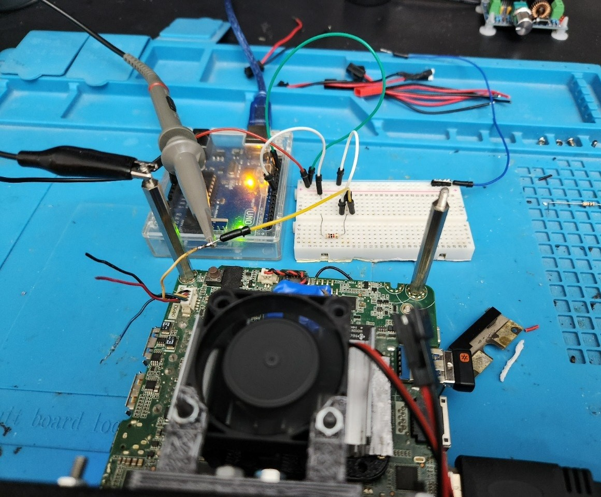
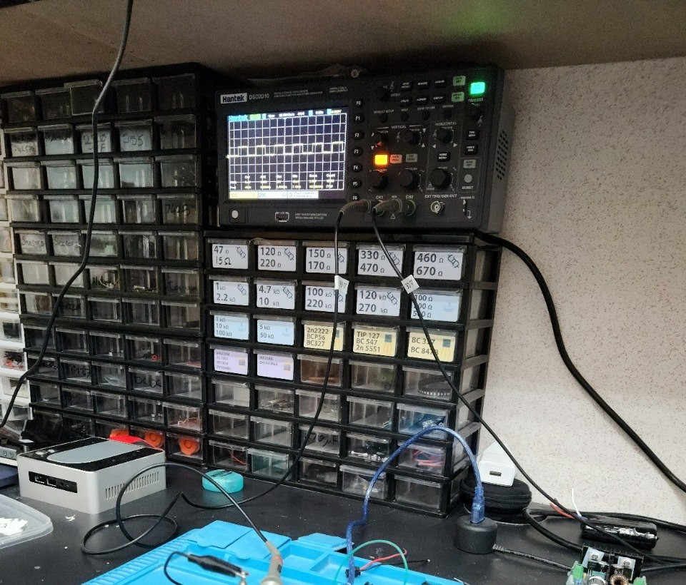
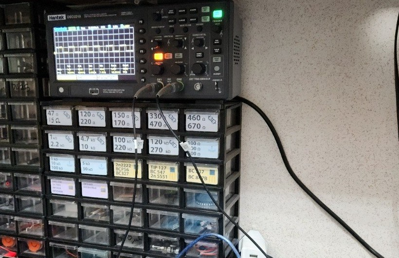

# nuc-fan-controller

A board that lets a 12 V two‑pin fan be used in place of a NUC's stock 5 V fan, and that
answers the NUC's tach input so the BIOS believes the fan it is asking for.

It does four things:

1. **bucks 19 V → 12 V** for the fans — LM2596T‑ADJ, 100 µH / 6 A toroid, 1N5822 catch diode,
   trimmed with a 10 kΩ multi‑turn pot to 12.0 V;
2. **12 V → 5 V → 3.3 V** for a 3.3 V / 8 MHz Arduino Pro Mini (AMS1117‑5.0 then AMS1117‑3.3,
   into the Pro Mini's **VCC**; RAW unused);
3. **follows the duty the NUC's ITE asks for** — the ITE's PWM wire is divided to 2.96 V, read
   on A0, and re‑made as 31.25 kHz on D11 driving Q2 → IRFZ44N → the fans;
4. **simulates the tach signal** — Timer1 hardware square wave on D9 sinks Q1's open collector;
   the pull‑up lives in the NUC. `RPM = 30 × f_tach` (the ITE IT8607E counts 2 pulses per turn).

Board: 124 × 85 mm, 2 layers, GND poured both sides with 326 stitching vias, `Power` net class
1.5 mm on 19V / SW / +12V / FAN_SW / +3V3 / GND. **ERC 0 violations. DRC 0 violations,
0 unconnected items**, one schematic‑parity warning: `J2` pin 4 carries a deliberate no‑connect
(it is the NUC header's own fan supply, which this board never touches).

## Open it without KiCad

[`exports/index.html`](exports/index.html) — schematic, both board views, BOM, links.

| File | What it is |
|---|---|
| `nuc-fan-controller.kicad_sch` / `.kicad_pcb` / `.kicad_pro` | KiCad 10 design |
| `exports/nuc-fan-controller_schematic.pdf` / `.svg` | schematic, wires not net labels, name tags on every signal net |
| `exports/nuc-fan-controller_board.pdf`, `…_board_bottom.pdf`, `…_board.svg` | board plots |
| `exports/nuc-fan-controller_bom.csv` | 38 fitted parts |
| `exports/fab/` | 8 Gerbers + `.drl` + `_pos.csv` + `job.gbrjob` — ready to zip and order |
| `firmware/nuc-tach-modeB/nuc-tach-modeB.ino` | the sketch; calibration constants at the top |
| `firmware/probe-uno/probe-uno.ino` | breadboard probe sketch for an Uno (5 V / 16 MHz): tach wave on D9 with the measured `ITE_READ_GAIN` applied, 31.25 kHz fan drive on D11 — for scope-checking the BC547 stages before the board exists |
| `firmware/probe-gain/probe-gain.ino` | sweep sketch: an exact ladder of tach claims (900–3000 RPM, 20 s each) with the fan following the ITE's demand, printing the divider's own count — measures the ITE's read gain and logs its fan curve |
| `firmware/probe-loop/probe-loop.ino` | test sketch: fan drive pinned, tach claims stepped 800 / 2000 / 4500 RPM — measures whether the ITE's demand answers the tach at all |
| `firmware/probe-temp/probe-temp.ino` | test sketch: claim frozen at 1500 RPM — measures whether the demand answers temperature, and what the ITE's floor demand is when the machine is cold |
| `firmware/probe-divider/probe-divider.ino` | test sketch: measures the divider's own ratio with nothing but the Uno, by feeding the chain from the Uno's 5 V pin so the rail voltage cancels |
| `bench/analyze-ladder.py`, `bench/analyze-temp.py`, `bench/analyze-cold.py`, `bench/analyze-heat.py` | the analysers that produced the numbers below, run against `bench/data/` — `analyze-heat.py` is the one that separates the cores from the board |
| `bench/data/` | the raw logs: 1 Hz traces of the divider reading, and of the NUC's temperatures |
| `BUILD.md` | the build sheet: header identification with a meter, buck trim, calibration, bench order |
| `archive/modeA-2026-10-19/` | the fixed‑RPM tach simulator this board replaced |

## On the bench

The board itself is not built yet. Its two control signals have been measured on a breadboard, with
an Uno standing in for the Pro Mini and the ITE's own behaviour logged at 1 Hz. Full numbers and the
raw logs are in `BUILD.md` and `bench/`; these are the measurements that changed the design.


**The harness into the NUC's fan header.** Four wires, no published pinout — `BUILD.md` identifies
them with a meter before anything is spliced. The tach and PWM wires go to the breadboard; the
header's own fan supply is left unconnected, which is the deliberate no‑connect on `J2` pin 4.


**The duty‑read chain.** The ITE's PWM wire through the series resistors to the tap, the tap to A0,
the bottom resistor and the caps to ground. A0 sits at the tap — put it at the far end of the chain
and nothing divides, because the AVR draws no current.


**The ITE's PWM is 23 kHz, not an assumption.** A scope on the PWM wire reads a 23 kHz square at
45 % duty mid‑sweep — inside Intel's 25 kHz ±10 % for a 4‑wire fan. At that frequency the divider and
C10/C11 are comfortably over‑specified: τ = 4.49 ms against a 43.5 µs period leaves 7 mV of ripple at
the ADC, 0.24 % of the duty span.

**The tach is read, and it is read 1 % low.** The scope on the tach line:


and the NUC's own hardware monitor, 40.000 Hz later:


1186 against a 1200 claim, 1188 at the same setting a minute later — the ITE's display steps by
2 RPM, and the gap is 0.990. That is `ITE_READ_GAIN`. Note what is on the same screen: CPU 58 °C,
memory 44 °C, motherboard ambient 40 °C. Those are the ITE's own sensors, and they turn out to be
what its fan policy runs on.

**The demand answers the board's temperature, not the cores, and not the reported speed.** Three tests,
all logged at 1 Hz. Stepping the claimed RPM 800 → 2000 → 4500 — a 5.6× swing — moved the ITE's requested
duty by 1.1 %, while the same claim swung 195–260 counts on its own: the reported speed is not in the
loop. Freezing the claim at 1500 RPM and driving the package 55 → 83 → 53 °C moved the reading 231 → 327
→ 230 counts, correlated at **r = +0.822 with a 4 s lag** — but that run had the bench fans switched by
hand, so the board rose with the cores (PCH 52 → 63.5 °C) and the two could not be told apart.

The third run tells them apart. Same sketch, same frozen claim, bench fans at maximum: `stress-ng --cpu 4`
for 300 s took the package 34 → 73 °C and it cooled back to 38 °C, the PCH only reached 55.5 °C, and
**the demand did not move at all** — 195–260 counts for eleven minutes, r = +0.049 against the cores.
Binned by the board instead, both runs together are monotone:

| PCH (the board) | n | median demand | as duty, 512 counts = 100 % | PWM wire average |
|---|---|---|---|---|
| 33–42 °C | 278 | 242 counts | 47.2 % | 2.36 V |
| 42–51 °C | 243 | 241 counts | 47.1 % | 2.35 V |
| 51–57 °C | 248 | 253 counts | 49.4 % | 2.47 V |
| 57–60 °C | 60 | 297 counts | 58.0 % | 2.90 V |
| 60–66 °C | 91 | 319 counts | 62.3 % | 3.12 V |

The decisive 192 samples have the cores at 68.5 °C and the board at 50.9 °C, and the ITE asks for exactly
what it asks for when everything is cold: 241 counts, 47 %. Above a board temperature of about 55 °C the
demand climbs at 2.0 duty points per °C. `bench/analyze-heat.py` reproduces these tables from the logs.

**The demand has a floor, and it is not near zero.** With the fans at maximum the package sat at 32–36 °C
for twelve minutes — 21 °C below the plateau the first temperature run had been stuck at — and the duty
did not follow it down: 196–260 counts, median 239, and not one sample of 717 below 100 counts. The floor
is 47 % duty, 2.35 V on the PWM wire, and it holds from the coldest measured board to a PCH of about
55 °C. So the fan this board drives never stops: `FAN_DUTY_MIN` is a clamp against a broken sense wire
rather than something the ITE ever reaches, and a fan that is always turning is a fan whose tach claim is
always plausible.

The fan also sits **inside** the ITE's loop — the fan cools the board, the ITE reads the board, the ITE
changes the demand — which is an enclosure requirement rather than a firmware one: air has to move across
the board and the ITE's own ambient sensor (the BIOS screen's "motherboard ambient", 40 °C against a CPU
at 58 °C), not only over the heatsink. The ITE will sit at its floor quite happily while the cores are at
73 °C.

**The demand is stepped, and the ITE cycles between the steps.** The dwell levels across all three runs are
198, 257 and 318 counts, spaced 58–61. Read as 512 counts = 100 % they are 3/8, 4/8 and 5/8 within 0.7
duty points, which is what a fan controller with a binary duty quantum looks like; read as 605 counts
the step is 9.9 points and matches nothing. The cycling is fast — 535 of 716 seconds moved by more than
3 counts, one dwell switching to the other in 1–3 s — so the follower filters it (tau 15 s, 1.5 duty
point deadband) instead of pumping the fan at 0.3 Hz while the machine's own thermal time constant is
minutes. The cycle is the ITE closing its loop through the fan: it asks for more duty, the board cools, it
asks for less.

**The divider is settled: two 10 kΩ.** The tap is half the PWM line, so on the Uno 512 counts is 100 %
duty and every count in `bench/data/` reads on that scale. In volts, which is what a meter should agree
with: the ITE's three dwell levels — 198, 257 and 318 counts — are **0.97 V, 1.26 V and 1.55 V at A0**,
i.e. **1.94 V, 2.51 V and 3.11 V average on the PWM wire**. That also argues for changing the board's
divider from 4.7 kΩ + 2.2 kΩ over 10 kΩ to 10 kΩ / 10 kΩ: 2.50 V on the tap instead of 2.96 V, 0.8 V of
headroom on a 3.3 V part instead of 0.34 V, one fewer resistor, and bench and board reading the same
scale.

**One thing the bench still has to settle: the top of the PWM swing.** 5.0 V or 5.5 V decides whether
100 % lands at 918 or 1009 counts on the present divider, and it comes from a *difference* rather than an
absolute reading — the two cold dwell levels are 0.571 V apart in average terms. A 1/8 duty step on a
5.0 V top predicts 0.625 V; on a 4.5 V top, 0.563 V. So either the ITE's top is nearer 4.6 V than 5.0 V
— plausible, since the stock blower is still on that header and a 4-wire fan's PWM input loads an
open-drain output — or its step is a little under 1/8. A meter on the PWM wire at the two dwell levels,
plus the two resistors themselves, puts all of it in one sitting.







## Build order, short version

1. Identify the four NUC fan‑header wires with a meter — Intel publishes no pinout.
2. Fit the buck only, trim to 12.0 V, then confirm 5 V and 3.3 V.
3. Find the fan's stall duty and measure its RPM at two duties; those four numbers are the
   constants at the top of the sketch.
4. Read TP1 with a frequency counter — it must equal `rpm / 30` Hz exactly, it is a hardware timer.
5. Tach side first (J2.1 + J2.2), then the PWM wire (J2.3), then the fans on J3/J4.

**Two things that break hardware:** a 12 V fan's tach or PWM wire spliced into the NUC header
(that fan pulls those lines to its own 12 V internally), and a 5 V FTDI on a 3.3 V Pro Mini
(ATmega328P absolute maximum on any pin is VCC + 0.5 V). Flash with Board → *Arduino Pro or Pro
Mini*, Processor → **ATmega328 (3.3V, 8MHz)**.

## Reproducing the design work

```
python3 logs/genwires.py                 # regenerates the schematic's wires/junctions from logs/layout.py
kicad-cli sch erc nuc-fan-controller.kicad_sch --output logs/erc.json --format json --severity-all
kicad-cli pcb drc nuc-fan-controller.kicad_pcb --output logs/drc.json --format json \
    --severity-all --schematic-parity --refill-zones --save-board
docker run --rm -v "$PWD/logs/routing:/work" eclipse-temurin:25-jre \
    java -Djava.awt.headless=true -jar /work/freerouting.jar \
    -de /work/nuc-fan-controller.dsn -do /work/nuc-fan-controller.ses -mp 150
```

The layout in `logs/layout.py` is the source of the schematic's geometry; `logs/genwires.py`
checks cross‑net crossings, wires through symbol bodies, pins on two nets and shorted parts
before it emits anything.

## Status

Design verified on paper and in the CAD; **the board is not built yet.** The control side has been
measured on a breadboard — the ITE's PWM frequency and amplitude, how it reads the tach, what drives
its demand, and where that demand bottoms out — see *On the bench*. `BUILD.md` is the bench sequence.
The fan-side constants (`FAN_RPM_MIN`, `FAN_RPM_FULL`, `ADC_AT_100PCT`) are still placeholders until a
real fan is fitted and measured; `ITE_READ_GAIN` has a measured value for the Uno driving this NUC and
needs the same measurement on the finished board.

No license is granted — all rights reserved. It is published so the drawings and the reasoning
behind them are readable.
